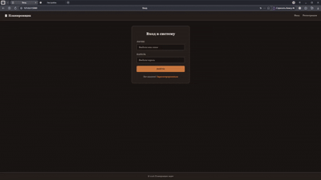
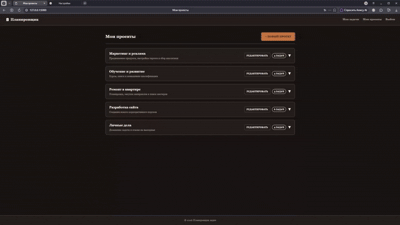
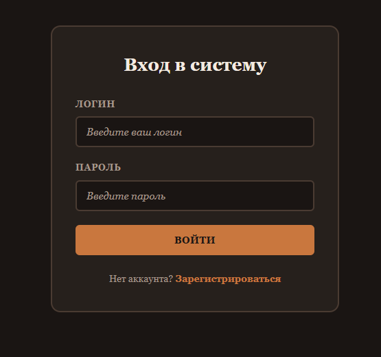
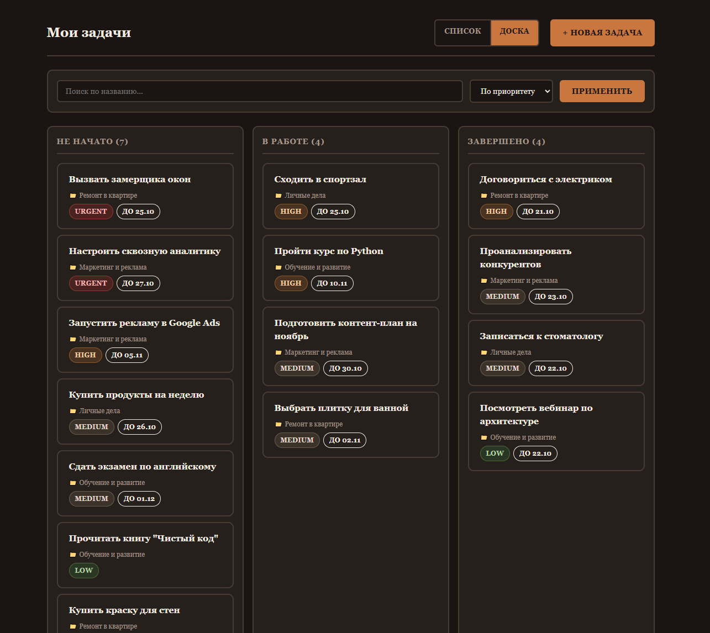
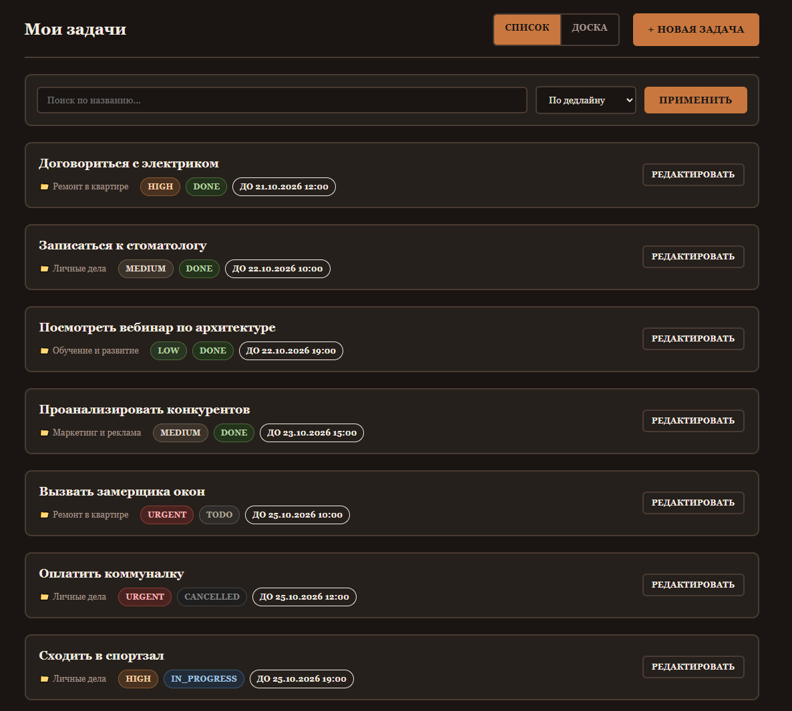
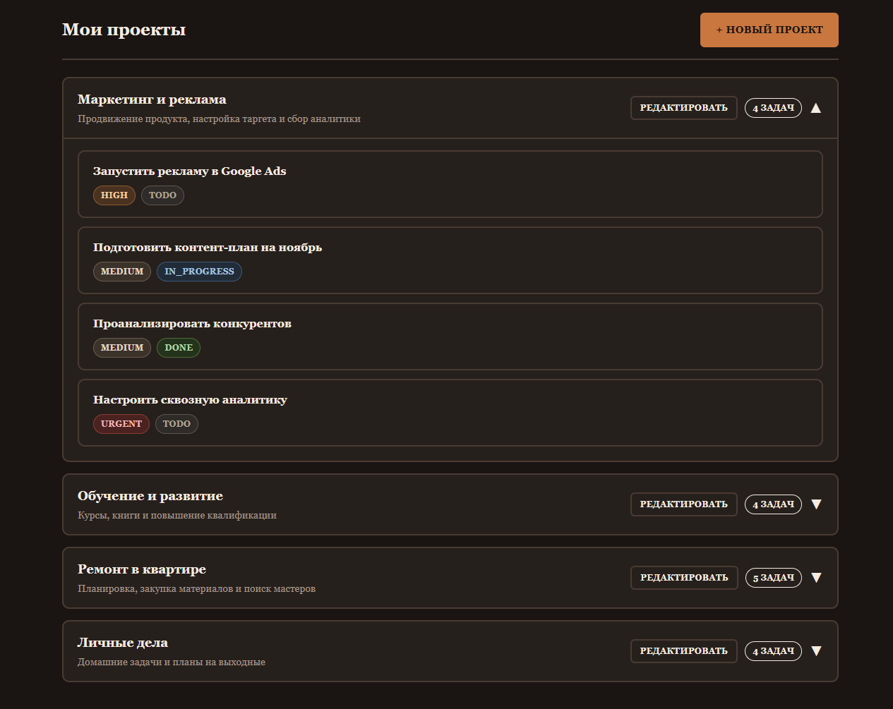
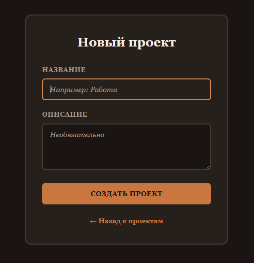
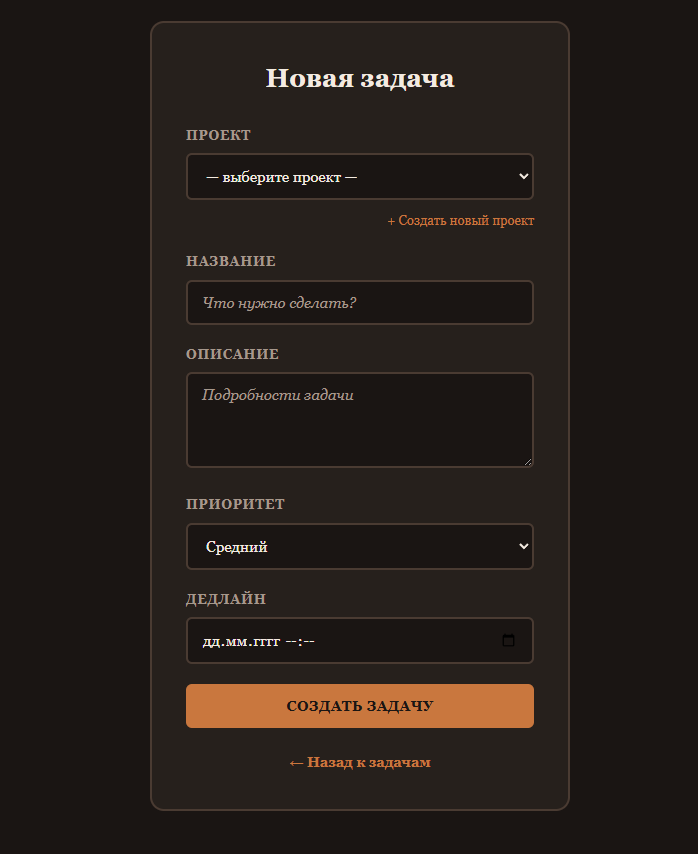

# 📋 Планировщик задач (Task Planner)

Веб-приложение для управления проектами и задачами, написанное на Python (Flask) с использованием базы данных PostgreSQL.

## Возможности

- Регистрация и авторизация пользователей (пароли хешируются).
- Создание, редактирование и удаление проектов.
- Создание, редактирование и удаление задач.
- Два режима отображения: Список и Kanban-доска.
- Поиск и сортировка задач.
- Привязка задач к проектам, приоритеты, дедлайны.


## 🎥 Демонстрация работы

### Вход и отображение задач.


### Создание нового проекта и задачи, а также их удаление.



## 📸 Скриншоты

### Вход в систему


### Kanban-доска


### Список задач


### Управление проектами


### Создание нового проекта


### Создание новой задачи



## 🚀 Быстрый старт

### 1. Требования

- Установленный Python (версия 3.9 или выше).
- Установленный PostgreSQL (версия 12 или выше).

### 2. Клонирование репозитория

```bash
git clone [https://github.com/MaksimRAG/task_planner_V2.git](https://github.com/MaksimRAG/task_planner_V2.git)
cd task_planner_V2
```

### 3. Создание виртуального окружения

```bash
# Windows
python -m venv .venv
.venv\Scripts\activate

# Linux / macOS
python3 -m venv .venv
source .venv/bin/activate
```

### 4. Установка зависимостей

```bash
pip install flask psycopg2-binary werkzeug
```

### 5. Настройка базы данных

1. Откройте `pgAdmin` или консоль PostgreSQL.
2. Создайте пустую базу данных, например `task_planner_V2`.
3. Откройте файл `db.py` и в словаре `conn_params` укажите ваши данные для подключения:

```python
conn_params = {
    "dbname": "task_planner_V2",
    "user": "postgres",
    "password": "ВАШ_ПАРОЛЬ",
    "host": "localhost",
    "port": "5432"
}
```

### 6. Инициализация базы данных

Запустите скрипт, который создаст таблицы и наполнит их тестовыми данными:

```bash
python init_db.py
```

### 7. Запуск приложения

```bash
python app.py
```

Приложение будет доступно по адресу: [http://127.0.0.1:5000](http://127.0.0.1:5000)

## 🔑 Тестовый аккаунт

Для проверки работы приложения используйте:

- **Логин:** `demo`
- **Пароль:** `admin123`

## 🛠 Технологии

- Python 3
- Flask
- PostgreSQL
- psycopg2
- HTML / CSS (Jinja2)